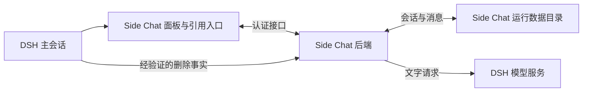
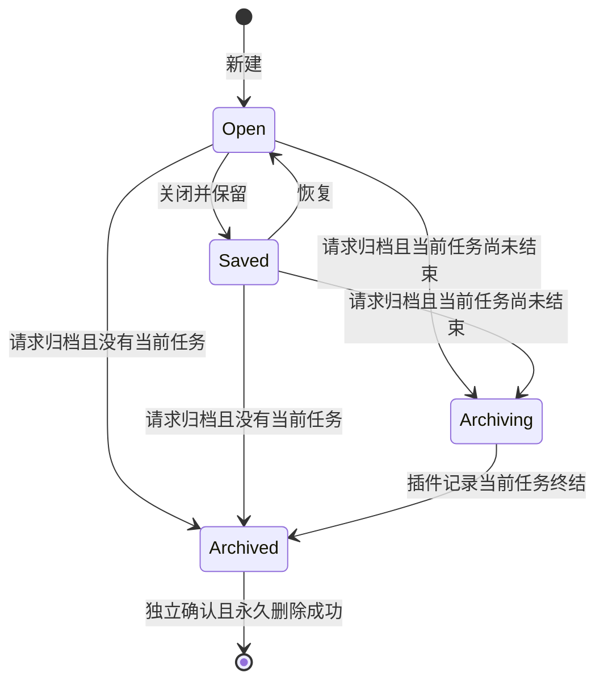
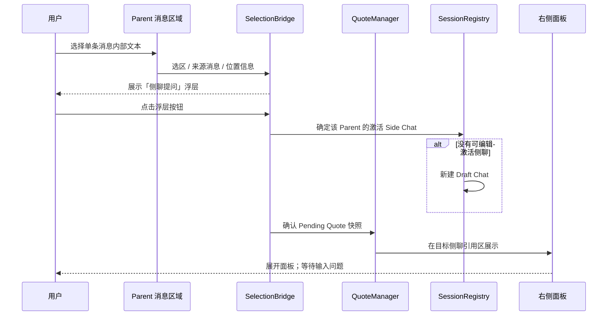

# Side Chat 插件架构设计（ARCHITECTURE）

- **版本**：V1.2（目标架构，独立会话尚待实现）
- **配套文件**：[Spec](./spec.md)

## 1. 架构目标与约束

- DSH 提供右侧栏入口、主会话读取和模型服务。插件拥有独立侧聊的完整生命周期与消息历史。
- 每条侧聊拥有稳定的 `sideChatId`，通过 `parentSessionId` 关联唯一主会话。工作区目录不参与侧聊存储定位。
- 插件后端直接请求 DSH 已配置的默认模型。调用不需要 DSH 会话 ID、Agent 循环、工作区工具或审批。

## 2. 逻辑拓扑

## 3. 模块职责和边界

| 边界 | 职责 |
| --- | --- |
| Side Chat 面板 | 显示当前主会话的侧聊和统一归档，捕获用户确认的选文，读取有界主会话背景，提交操作并展示后端状态。 |
| Side Chat 后端 | 通过认证接口管理侧聊、草稿、历史、请求准入、执行状态、归档及删除。模型任务由后端持有，独立于面板挂载和浏览器连接。 |
| 持久化 | 保存独立侧聊的权威记录，支持按主会话查询、跨主会话查阅归档和重启恢复。 |
| DSH 适配层 | 封装侧栏、主会话读与经验证的删除信号，以及后端默认模型选择与调用。DSH 负责解析模型路由与凭据。 |

## 4. 数据归属与存储

- 独立会话的权威记录位于插件专用运行数据目录 `$DSH_HOME/side-chat/`。未设置 `DSH_HOME` 时使用 `~/.dsh/side-chat/`。后端读写本地数据，浏览器通过认证接口访问。
- V1 使用 `side-chat.sqlite3` 保存会话、消息、引用、背景和请求状态。后端在同一事务内接受提交、保存用户消息及其材料、更新请求状态并清除本次提交对应的草稿与待发送引用。按 `parentSessionId` 查询侧聊，按管理状态查询统一归档。
- 每条侧聊可按自己的 ID 独立持久化和读取。记录包含主会话来源、标题、管理状态、草稿、消息、已发送引用、适用的背景快照和请求状态。每个主会话的最近激活项按主会话 ID 记录。
- 引用保存原文快照和可获得的来源消息标识。背景快照保存实际发送文本、来源范围、获取时间和节选信息。插件只保存实际需要的引用和背景，不复制完整主会话。
- 独立记录与旧版的 DSH 会话映射可明确区分。旧 DSH 侧聊的历史由原工作区管理，独立存储不读取、迁入或删除旧 DSH 会话。后端通过 DSH 服务使用凭据，侧聊数据和前端接口均不包含凭据。
- 存储须能识别数据版本并对损坏记录报告读取错误，避免用空记录覆盖。

### 4.1 后续附件存储

- 附件原件保存在 `$DSH_HOME/side-chat/attachments/<侧聊 ID>/`，由后端分配磁盘文件名。SQLite 记录附件 ID、原始文件名、类型、大小、相对路径，以及草稿或已发送消息的归属。后端校验上传完成后才使附件可发送，预览和下载通过认证接口。
- 图片发送取决于所选模型及 DSH 接入是否支持图片输入。文本文件以用户确认的文本范围发送，并保存实际提交的内容以供重试。其他格式须有经验证的原生文件输入或文本提取能力。
- 归档保留消息与关联附件。永久删除须清理数据库记录和附件原件，清理失败时保留可追踪状态。V1 只实现文字问答，附件目录和数据表在接入附件功能时创建。

## 5. 状态模型与不变量

- 面板展开状态、选中侧聊、会话管理状态和请求执行状态相互独立。每个主会话最多有一个最近激活项，指向该主会话可编辑的侧聊。
- 侧聊从草稿阶段起就有插件 ID。切换、关闭面板或浏览器断开不改变请求的执行归属。
- 后端是侧聊任务状态的权威来源。异步结果按发起时的侧聊 ID 和操作标识写回，不能写入完成时选中的侧聊。
- 请求准入与归档状态更新须协调。归档开始后禁止接受新提交，已接受的请求可以结束并写入原侧聊。

### 5.1 管理状态流转

## 6. 关键数据流

### 6.1 新建、发送与执行

1. 新建时保存插件草稿并将其设为激活。
2. 发送时锁定侧聊身份、草稿和引用。首轮无主动引用时，按 Spec 读取并冻结主会话背景。
3. 后端以稳定的操作标识接受提交，持久化用户消息、发送材料及请求状态。重复提交同一操作只返回已有状态。客户端仅在确认接受后清除本次提交对应的草稿和待发送引用。
4. 后端调用 DSH 模型服务，以侧聊历史及本轮问题和材料组成请求。保存完整回复和终态，再由面板展示。
5. 客户端超时或重连时按操作标识查询原请求。后端重启时保留已经落盘的内容，将无法确认终态的请求标为中断或结果未知，禁止自动重发。显式重试复用原提交材料，避免重复记录同一问题。

### 6.2 选文与引用

浮层仍未点击时的 Candidate 不落入持久化 Pending Quotes。跨 Parent 切换使 Candidate 失效，已经确认的引用仍绑定原 Side Chat。

### 6.3 主会话背景

- 主会话读取锁定原 Parent 和消息截止范围，按 Spec 预算补读已完成的普通用户与助手正文。读取失败保留草稿并报告错误。
- 首轮冻结的背景与提交一并保存，发送重试复用。后续请求由插件历史重建，已发送背景随原首轮消息参与历史，不重新读取主会话；面板不重复展示背景正文。
- 引用和背景作为模型待分析的外部材料传递，不能提升为系统指令或权限来源。

### 6.4 归档、恢复与永久删除

- 普通恢复和统一归档都读取插件自己的历史。统一归档按保存的来源标识展示跨主会话数据，即使原主会话不存在。
- 存在已接受请求时保存归档中状态。后端记录请求成功、失败或中断后完成归档，恢复过程中不得把未知状态当作已成功。
- 永久删除只操作已明确确认的独立侧聊及关联数据。后端确认删除结果后才反馈成功，并清理失效的激活指针。

## 7. 主会话删除联动

- 只有经验证的删除事件或权威存在性结果才能触发联动。运行实例 `removed`、列表暂时缺失、权限或加载错误均不足以证明删除。
- 确认删除后，后端按 `parentSessionId` 归档关联独立侧聊，运行中的请求遵守等待终态规则。删除确认与历史读取均不依赖原主会话面板保持打开。
- 无法获得可靠证据时保留侧聊并提示无法确认。自动联动及离线期间删除的补查取决于宿主提供的能力。
